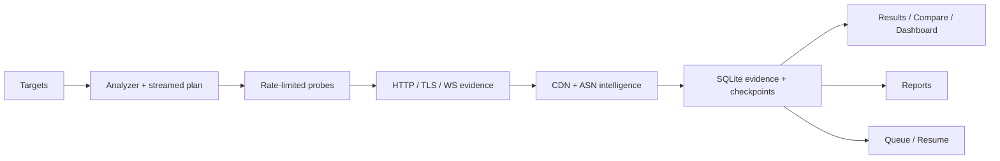

<div align="center">

# NOWAY Edge Scanner

**Native Android, Windows GUI, Windows CMD and Termux tools for authorized CDN, CIDR and response diagnostics.**

[](https://github.com/drabkb786/Noway-apps/actions/workflows/build.yml)
[](https://github.com/drabkb786/Noway-apps/actions/workflows/android.yml)
[](https://github.com/drabkb786/Noway-apps/releases/tag/v2.3.1)


[](LICENSE)

[Download](https://github.com/drabkb786/Noway-apps/releases) · [Android APK](ANDROID.md) · [Windows GUI](WINDOWS.md) · [Windows CMD](CMD.md) · [Termux](TERMUX.md) · [Security](SECURITY.md)

</div>

---

NOWAY combines streamed target planning, HTTP/TLS/WebSocket evidence, CDN intelligence, durable checkpoints and exports in local-first tools. Use the native Android app, full Windows desktop workspace, portable Windows CMD build, or the `noway-scan` command in Termux.

> **Authorized use only.** Scan only systems, domains and address space you own or have explicit permission to test. The project intentionally excludes exploit execution, credential attacks, billing/zero-rating bypass, traffic-tunneling bypass and remote-control functionality.

## Download

Latest verified platform packages:

| Platform | Version | Release asset | Start |
|---|---:|---|---|
| Native Android APK | 2.3.1 | `NOWAY-CDN-CIDR-Scanner-v2.3.1-Android.apk` | Install, then open NOWAY |
| Windows GUI | 2.2.0 | `NOWAY-CDN-CIDR-Scanner-v2.2.0-Windows-Portable.zip` | `NOWAY-CDN-CIDR-Scanner.exe` |
| Windows CMD | 2.2.0 | `NOWAY-CDN-CIDR-Scanner-v2.2.0-Windows-CMD-Portable.zip` | `NOWAY-Scanner-CMD.cmd --help` |
| Android Termux | 2.2.0 | `NOWAY-CDN-CIDR-Scanner-v2.2.0-Termux.zip` | `bash termux/install.sh` |

The Android release includes its own `SHA256SUMS-Android.txt`; follow the full [Android install and usage guide](ANDROID.md). The Windows packages need no Python installation or administrator access. Extract the complete portable folder and keep its runtime files together. The Termux ZIP contains the source package plus a native installer; see [TERMUX.md](TERMUX.md).

## v2 at a glance

| Workspace | What it does |
|---|---|
| Dashboard | Engine state, queue health, response/latency/CDN/ASN charts and recent activity |
| Native Android | Scrollable scan builder, phone performance presets, live results and resumable history |
| Scanner | Guided Targets → Analyze → Configure → Review → Queue/Run flow |
| Scan Queue | Durable ordered multi-job scheduler with pause/resume/recovery |
| Target Cleaner | Duplicate/invalid cleanup plus conservative DNS + TCP health checking |
| Results | Saved evidence explorer with ASN/CDN context and advanced filters |
| Compare | Added/Removed/Changed/Unchanged scan diff with evidence facets |
| Reports | HTML, CSV, JSON, Markdown and ZIP evidence bundles with SHA-256 manifest |
| Profiles | Reusable safe scan configurations with import/export |
| History | Durable local jobs and checkpoint resume |

## Core capabilities

- Hostnames, full URLs, IP literals, inclusive IPv4/IPv6 ranges and CIDRs.
- TXT/CSV target import and analytical target/check counting for very large plans.
- HTTP, HTTPS, WS and WSS with verified WebSocket 101 handling.
- Custom ports/ranges, path, method, Host header, TLS SNI and request headers.
- Match rules including status codes such as 101, 200 and 204.
- Evidence-backed CDN identification using DNS/CNAME, headers, network ranges, TLS and server signals.
- ASN, BGP prefix, registry country and organization enrichment for public resolved IPs.
- Configurable worker count, request rate, timeout and retry behavior.
- Durable SQLite jobs, safe pause/resume and restart recovery.
- Local-only profile/filter/queue state and no NOWAY account requirement.

## CMD and Termux quick start

Both console editions expose the same scan, job history, resume, result, and export commands:

```text
noway-scan scan 127.0.0.1 --ports 80,443 --i-am-authorized
noway-scan jobs
noway-scan resume 3
noway-scan results 3 --matches-only
noway-scan export 3 NOWAY-results.csv --format csv
```

On Windows CMD, replace `noway-scan` with `NOWAY-Scanner-CMD.cmd`. The explicit `--i-am-authorized` confirmation is required for every newly created scan. Full instructions are in [CMD.md](CMD.md) and [TERMUX.md](TERMUX.md).

## Smart Target Analyzer

The Scanner analyzes target text before execution and reports:

- Valid/invalid lines.
- Duplicate canonical targets.
- Selected-mode mismatches.
- Host/URL/IP/range/CIDR counts.
- IPv4/IPv6 counts.
- Analytical expanded target totals without eagerly materializing huge CIDRs.

For valid input, the primary action remains clickable and explains the next step. It refreshes the local plan on every click, guides the user to explicit Authorization when needed, and then runs the reviewed plan.

## Data Explorer and filters

Live Results, Saved Results and Compare share a consistent explorer interaction layer:

- Multi-row selection and clipboard actions.
- Details drawer for endpoint, response and infrastructure context.
- Essential / All column presets and individual column visibility.
- Compact / Comfortable row density.
- Status exact/list/class/range filters, e.g. `200`, `200,204`, `2xx`, `401-403`.
- Port exact/list/range filters.
- Protocol, latency, CDN, ASN, organization, error and match-state filters.
- Saved filter presets for repeat analysis.

## Reports and evidence bundles

Reports can be exported as HTML, CSV, JSON or Markdown. The ZIP report bundle can contain:

- `report.html`
- `report.csv`
- `report.json`
- `report.md`
- `manifest.json`
- optional raw saved evidence JSONL
- optional comparison CSV/JSON

The manifest records SHA-256 hashes and file sizes for included report files. Large HTML reports use a bounded evidence preview while machine-readable exports retain the full selected dataset.

## Queue safety

The persistent queue executes one scan plan at a time instead of launching several high-concurrency engines in parallel.

- Queue order survives app restart.
- Running/pausing items recover into safe non-running states after an interrupted session.
- Authorization is not persisted as `true`.
- Sensitive request headers are not persisted in queue configuration.
- Recovered work does not automatically generate network traffic after restart; the user must arm the session again.

## Profile safety

Reusable profiles never persist authorization confirmation. Authorization, cookies, API keys, access tokens, secret/password-like headers and related sensitive values are removed when a profile is captured.

Imported profile JSON is **re-sanitized**, so manually edited files cannot reintroduce those sensitive headers into persistent profile storage.

## Visual system and navigation

v2.2 retains the responsive Windows UI/UX introduced in v2.1:

- Deep Navy dark and Studio Light themes with teal/indigo accents.
- Independently scrollable grouped navigation and content workspaces.
- A stacked Scanner layout at laptop sizes and a split workspace on larger displays.
- Command Center dashboard and live queue context.
- Compact / Standard / Wide responsive desktop layouts.
- Restrained page/toast/status motion with Reduce Motion support.
- Useful empty states and focus/keyboard polish.

Keyboard shortcuts:

| Shortcut | Action |
|---|---|
| `Ctrl+1` | Dashboard |
| `Ctrl+2` | Scanner |
| `Ctrl+3` | Scan Queue |
| `Ctrl+4` | Results |
| `Ctrl+5` | Compare |
| `Ctrl+6` | Reports |
| `Ctrl+Enter` | Review and start a valid scan |
| `Ctrl+P` | Preview plan |
| `Ctrl+O` | Import targets |
| `F1` | Quick Help / Reduce Motion |
| `Esc` | Dismiss help/toast |

## Performance controls

Android v2.3.1 provides Eco (8), Safe (16), Balanced (32), Fast (48), Heavy (64) and Extreme (96) worker presets plus Custom from 1–256. Balanced is the recommended starting point. More than 96 workers, more than 500 checks/sec, or over one million planned checks requires a second confirmation. See [ANDROID.md](ANDROID.md) for heat, battery and Wi-Fi guidance.

Windows presets range from Safe (64 workers) through Maximum (1024), plus Custom. More workers do not automatically mean higher throughput: network latency, router/NAT capacity, remote service behavior and rate limits matter more than CPU thread count for many scans.

Values above 512 workers retain an extra confirmation step. Start conservatively and raise concurrency only while timeout/reset/error rates remain stable.

## Local data

Primary Windows evidence is stored in:

`%APPDATA%\NOWAY Scanner\scans.db`

Profiles, filter presets and queue state are stored in the same local application-data area. NOWAY does not upload targets, scan results or analytics to a NOWAY server.

## Release trust

The v2 Windows GUI and CMD packages are Nuitka **standalone** builds, not self-extracting one-file wrappers. The Windows release workflow:

1. Runs static validation and the complete Windows test suite.
2. Runs the final headless `desktop/ux_polish_app.py --self-test` chain.
3. Verifies a 1024×640 scrollable Scanner and the actual auto-review RUN NOW path.
4. Compiles the standalone Windows GUI and CMD executables.
5. Runs packaged GUI, RUN NOW, CMD help/version and local-only CLI scan smoke tests.
6. Assembles and installs the Termux source bundle in a clean Linux environment.
7. Scans both Windows portable folders and ZIPs with Microsoft Defender.
8. Publishes SHA-256 checksums for all three ZIPs.

The Android workflow separately runs unit tests, assembles the APK, verifies its archive, signature, package ID and version metadata, then publishes the APK with a SHA-256 checksum. The APK is debug-signed for sideloading; an older build signed by a different runner may need to be uninstalled first.

The EXE is not Authenticode-signed with a commercial certificate, so SmartScreen may show **Unknown publisher**. That reputation prompt is separate from an antivirus malware detection. See [WINDOWS.md](WINDOWS.md) for verification and reporting guidance.

## Build from source

Python validation:

```bash
python -m pip install -e '.[dev]'
python -m pytest
python desktop/ux_polish_app.py --self-test
```

Run the shared CLI from source:

```bash
python -m noway_scanner --help
python -m noway_scanner scan 127.0.0.1 --ports 80,443 --i-am-authorized
```

Windows standalone build requires Windows, Python 3.12 and the desktop build dependencies:

```powershell
python -m pip install -e ".[desktop]" pillow
python desktop/build_icon.py desktop/NOWAYScanner.ico
python -m nuitka --mode=standalone `
  --windows-console-mode=disable `
  --enable-plugin=tk-inter `
  --include-package=noway_scanner `
  --include-package=dns `
  --windows-icon-from-ico=desktop/NOWAYScanner.ico `
  desktop/ux_polish_app.py
```

Build the native Android app with Java 17 and Gradle 8.9:

```bash
gradle :android:testDebugUnitTest :android:assembleDebug --stacktrace --no-daemon
```

The reproducible release definitions are in `.github/workflows/build.yml` and `.github/workflows/android.yml`.

## Architecture



## Responsible operation

- Use only explicitly authorized targets and address space.
- Start with conservative worker/rate settings.
- Respect service-owner limits, maintenance windows and local law.
- Treat exported hostnames, IPs, headers and TLS identities as potentially sensitive data.
- Do not disable antivirus protection to run a downloaded build.

## License

Released under the [MIT License](LICENSE). Authorization and lawful use remain the operator's responsibility.
